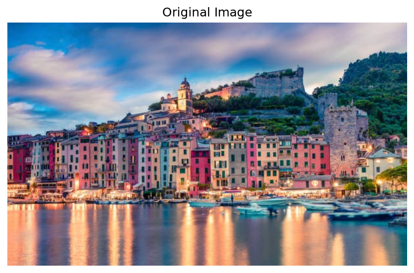
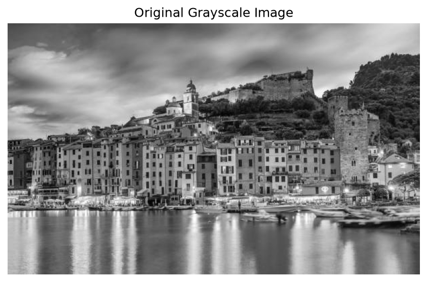
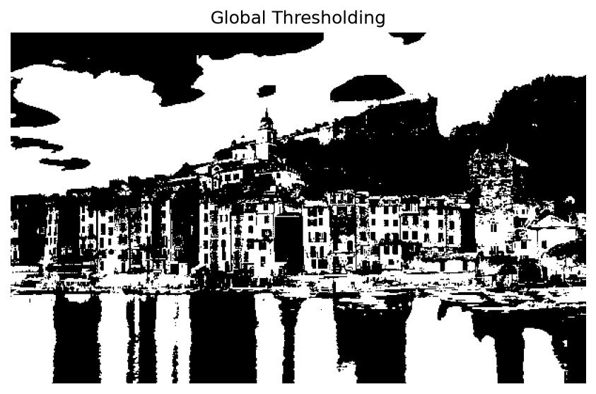
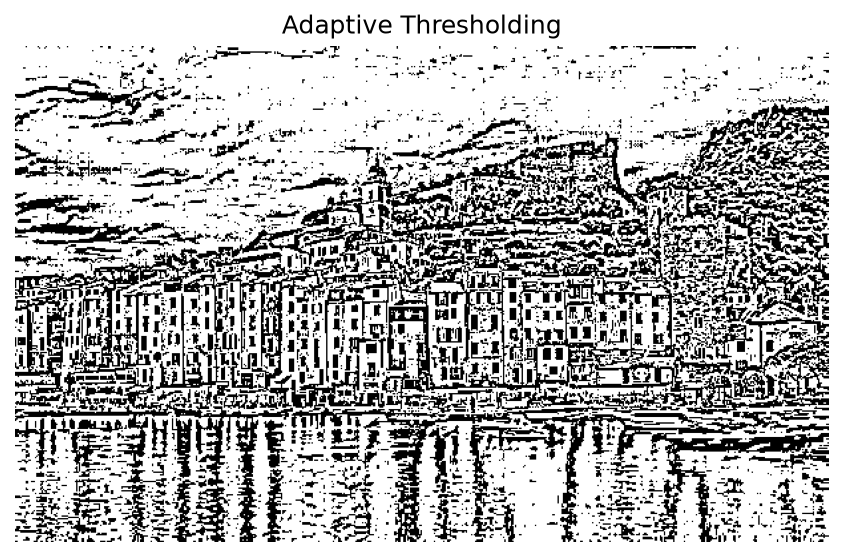
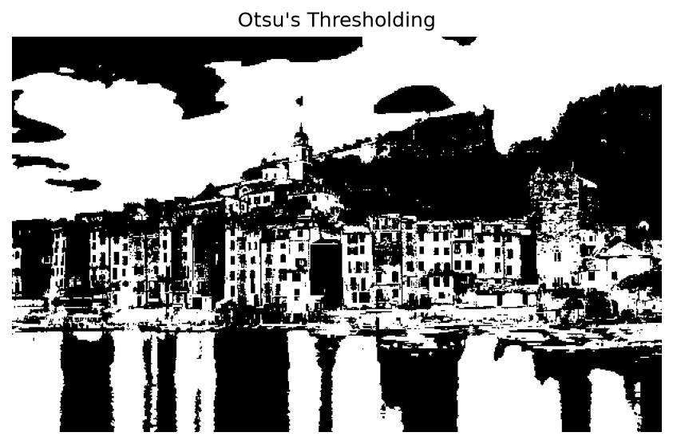

# Image Segmentation Using Thresholding Techniques in OpenCV

## Developed By

**Name:** Subashini K

**Register No:** 212225240160

## Aim

To segment an image using Global Thresholding, Adaptive Thresholding, and Otsu's Thresholding techniques using Python and OpenCV.

The program performs the following operations:

- Global Thresholding
- Adaptive Thresholding
- Otsu's Thresholding

## Software Used

- Anaconda – Python 3.7
- Jupyter Notebook / VS Code
- OpenCV (cv2)
- NumPy
- Matplotlib

## Algorithm

### Step 1:

Import the required libraries: OpenCV, NumPy, and Matplotlib.

### Step 2:

Load the input image using OpenCV.

### Step 3:

Convert the input image into grayscale format.

### Step 4: Global Thresholding

- Select a fixed threshold value.
- Apply thresholding to separate foreground and background pixels.
- Display the thresholded image.

### Step 5: Adaptive Thresholding

- Compute threshold values for small regions of the image.
- Apply Adaptive Mean Thresholding.
- Apply Adaptive Gaussian Thresholding.
- Display the segmented images.

### Step 6: Otsu's Thresholding

- Automatically determine the optimal threshold value.
- Apply Otsu's thresholding technique.
- Display the segmented image.

### Step 7:

Compare the results obtained from Global, Adaptive, and Otsu's thresholding methods.

## Program

## Developed By

**Name:** Subashini K 

**Register No:** 212225240160

## Output
### Original Image
```python
import cv2
import matplotlib.pyplot as plt

img = cv2.imread("city.jpg")

if img is None:
    print("Error: Image not found. Check the file path.")
else:
    img_rgb = cv2.cvtColor(img, cv2.COLOR_BGR2RGB)
    plt.imshow(img_rgb)
    plt.title("Original Image")
    plt.axis("off")
    plt.show()
```



### Original Grayscale Image
```python
import cv2
import matplotlib.pyplot as plt
img = cv2.imread("city.jpg", cv2.IMREAD_GRAYSCALE)
plt.imshow(img, cmap="gray")
plt.title("Original Grayscale Image")
plt.axis("off")
plt.show()
```



### Global Thresholding
```python
import cv2
import matplotlib.pyplot as plt
img = cv2.imread("city.jpg", cv2.IMREAD_GRAYSCALE)
_, result = cv2.threshold(img, 127, 255, cv2.THRESH_BINARY)
plt.imshow(result, cmap="gray")
plt.title("Global Thresholding")
plt.axis("off")
plt.show()
```



### Adaptive Thresholding

```python
import cv2
import matplotlib.pyplot as plt
img = cv2.imread("city.jpg", cv2.IMREAD_GRAYSCALE)
result = cv2.adaptiveThreshold(
    img, 255,
    cv2.ADAPTIVE_THRESH_GAUSSIAN_C,
    cv2.THRESH_BINARY,
    11, 2
)
plt.imshow(result, cmap="gray")
plt.title("Adaptive Thresholding")
plt.axis("off")
plt.show()
```


### Otsu's Thresholding
```python
import cv2
import matplotlib.pyplot as plt
img = cv2.imread("city.jpg", cv2.IMREAD_GRAYSCALE)
_, result = cv2.threshold(
    img, 0, 255,
    cv2.THRESH_BINARY + cv2.THRESH_OTSU
)
plt.imshow(result, cmap="gray")
plt.title("Otsu's Thresholding")
plt.axis("off")
plt.show()
```



## Result

Thus, image segmentation is successfully performed using **Global Thresholding, Adaptive Thresholding, and Otsu's Thresholding** techniques in OpenCV.
